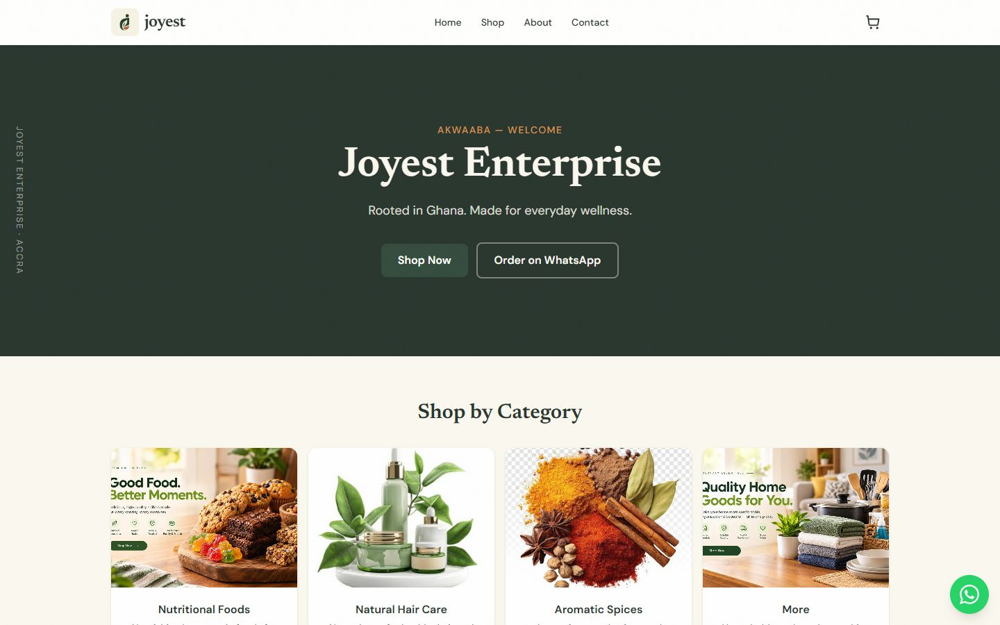

# Joyest Enterprise — storefront

E-commerce-lite storefront for **Joyest Enterprise** (Accra, Ghana): nutritional foods, natural hair care, aromatic natural spices, and everyday home goods. Customers browse the catalogue and order via **WhatsApp** — every order is also saved to **Supabase** so nothing is lost.

**Live:** [https://joyest.vercel.app](https://joyest.vercel.app)



## Table of contents

- [Features](#features)
- [Tech stack](#tech-stack)
- [Getting started](#getting-started)
- [Environment variables](#environment-variables)
- [Supabase setup](#supabase-setup)
- [Admin area](#admin-area)
- [Commands](#commands)
- [Project structure](#project-structure)
- [Deployment](#deployment)
- [Further docs](#further-docs)

## Features

**Storefront** (`app/(site)/`)
- Home with category tiles, featured products, brand story, YouTube video
- Shop filtered by category + product detail pages (gallery, ingredients/benefits/usage, badges)
- About + Contact (mailto-composed enquiry form) pages
- Cart drawer → **WhatsApp** or email ordering; WhatsApp is the primary channel (payments are offline/manual — no online checkout)
- Every cart order is **also POSTed to Supabase** in the background (fire-and-forget — WhatsApp still opens even if the save fails)

**Admin area** (`/admin`)
- Password login with signed HttpOnly session cookies (7 days)
- Dashboard: product count, new/open order counts, latest orders
- Products: create / edit / delete, photo upload to Supabase Storage, badges, featured flag, detail sections
- Orders: filter by status; mark confirmed / fulfilled / cancel / restore
- See [Admin area](#admin-area) below

**Platform**
- Catalogue served from Supabase Postgres with automatic fallback to static files in `data/`
- SEO: Open Graph + Twitter cards, JSON-LD `Store` schema, canonical URLs, sitemap, robots (with `/admin` disallowed), static OG image
- PPR (Partial Prerender) on catalog pages; loading skeletons throughout

## Tech stack

| Layer | Choice |
|---|---|
| Framework | Next.js **16** (App Router, Cache Components, Turbopack) |
| UI | React 19, Tailwind CSS v4 (semantic brand tokens) |
| Backend | Supabase — Postgres (catalog + orders), Storage (product images) |
| Fonts | Newsreader (serif) · DM Sans (body) · Manrope (UI) via `next/font` |
| Package manager | pnpm |
| Hosting | Vercel ([joyest.vercel.app](https://joyest.vercel.app)) |

## Getting started

```bash
pnpm install
```

Create a `.env` file in the project root (see [Environment variables](#environment-variables)).

```bash
pnpm dev        # http://localhost:3000
```

First-time backend setup: apply the schema and seed the catalogue — see [Supabase setup](#supabase-setup).

## Environment variables

Put these in `.env` locally and in **Vercel → Settings → Environment Variables** for production.
(Values are secrets — they are intentionally not listed here.)

| Variable | Purpose |
|---|---|
| `NEXT_PUBLIC_SUPABASE_URL` | Supabase project URL |
| `NEXT_PUBLIC_SUPABASE_ANON_KEY` | Public API key — catalogue reads (RLS-scoped) |
| `SUPABASE_SERVICE_ROLE_KEY` | Server-only key — order writes, admin CRUD, seeding |
| `ADMIN_PASSWORD` | Password for `/admin` login |
| `SESSION_SECRET` | Random 64-char hex — signs admin session cookies |

> ⚠️ When setting env vars from a Windows PowerShell prompt, pipe from a file or `node -e "process.stdout.write(...)"` rather than `"value" | vercel env add` — PowerShell appends a trailing newline that breaks HMAC verification.

## Supabase setup

1. Create a project at [supabase.com](https://supabase.com)
2. **SQL Editor** → paste & run [`supabase/schema.sql`](./supabase/schema.sql)
   - Creates `categories`, `products`, `orders` with Row Level Security:
     - anon key: read catalog only
     - orders: invisible to anon; writes only via the server (service role)
3. Seed the catalogue (4 categories + 11 products from `data/`):

   ```bash
   pnpm seed
   ```

   Safe to re-run (upserts). Uses `SUPABASE_SERVICE_ROLE_KEY` — the anon key is blocked by RLS on purpose.
4. Create a **public Storage bucket** named `product-images` (5 MB limit) for admin photo uploads — or via the dashboard: Storage → New bucket → public.

## Admin area

**URL:** [https://joyest.vercel.app/admin](https://joyest.vercel.app/admin)

- Sign in with `ADMIN_PASSWORD` (share with staff via a secure channel, not in chat/git)
- Session = signed HttpOnly cookie (7 days) enforced by `proxy.ts` (Next 16's middleware) **and** re-checked inside every server action
- `/admin` is disallowed in `robots.txt`

| Screen | What it does |
|---|---|
| Dashboard | Counts (products, new orders, open orders) + latest orders |
| Products | Table of all products; add / edit / delete; photo upload → Supabase Storage; auto-slug; `id` is immutable after creation |
| Orders | All captured WhatsApp orders with items, totals, notes; status filter chips; one-click status transitions (`new → confirmed → fulfilled`, cancel, restore) |

Product changes revalidate the storefront immediately — new/edited products appear on `/shop` without waiting for a redeploy.

## Commands

```bash
pnpm dev        # dev server
pnpm build      # production build (lint + type-check + prerender)
pnpm lint       # eslint
pnpm start      # serve the production build
pnpm seed       # upsert static catalog into Supabase
```

## Project structure

```
app/
  (site)/          # public storefront (header/cart/footer chrome)
    page.tsx       # home
    shop/          # catalogue + product pages
    about/ contact/
  admin/           # password-gated admin (dashboard, products, orders)
  api/
    orders/        # POST — public order capture (WhatsApp flow)
    admin/         # login/logout form handlers
  layout.tsx       # bare root layout (fonts, globals)
components/        # storefront + components/admin/
data/              # static fallback catalog (source for pnpm seed)
lib/
  catalog.ts       # Supabase-first reads w/ static fallback
  admin/           # session signing, auth guards, service-role data layer
  supabase/        # anon + service-role clients
supabase/
  schema.sql       # tables + RLS — run once in the SQL editor
docs/
  plan.md          # design system + build plan
  task-log.md      # full build history
proxy.ts           # Next 16 middleware — gates /admin
homepage.jpg       # screenshot used in this README
```

## Deployment

- Hosted on **Vercel** (project `joyest`); every push/deploy is a production release
- `.vercelignore` keeps `Replit App/`, `.opencode/`, `.tmp/` and `docs/` out of deployments
- All five env vars above must exist in Vercel **before** deploy; the site silently falls back to the static catalog if Supabase is unreachable, and order capture returns `503` without the service-role key

## Further docs

- [`docs/plan.md`](./docs/plan.md) — brand tokens, design system, architecture decisions
- [`docs/task-log.md`](./docs/task-log.md) — chronological build log (every task, fix and deployment)
- Client requirements original source: Google Sheets enquiry (2026-10-09) — summarised in `docs/plan.md`
